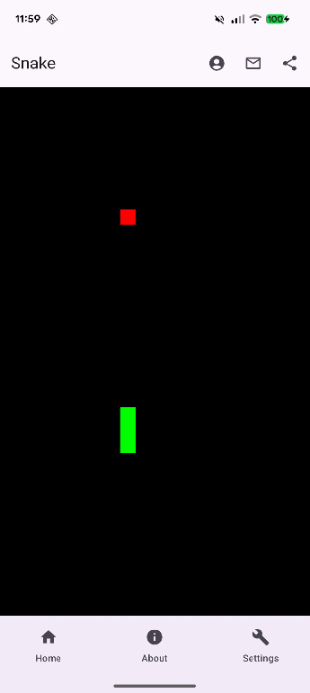
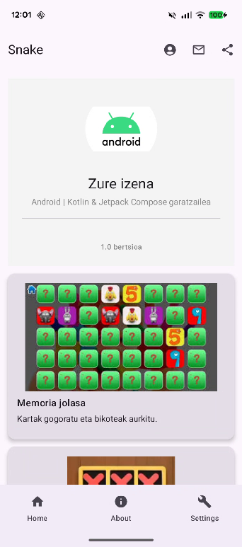
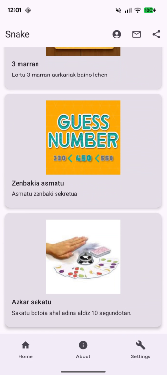
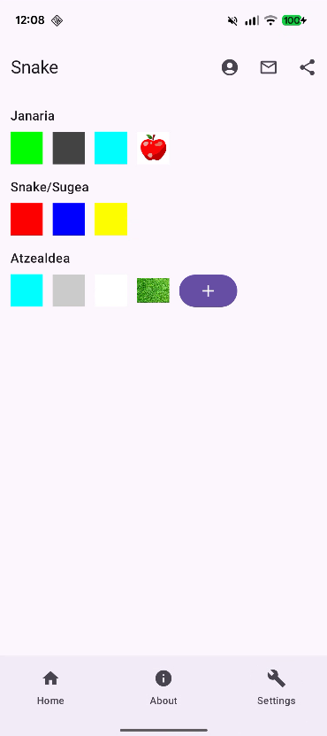
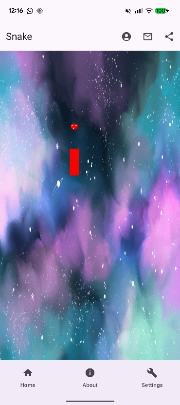

# 🐍 Snake — Jetpack Compose azterketa

**Snake** bideojoko klasikoa da. Jokalariak pantailan mugitzen den suge bat kontrolatzen du hazteko janaria jan behar duena.

---

## Funtzionamendua

Jokalariak sugearen norabidea kontrolatzen du **gora, behera, eskuinera edo ezkerrera sakatuz**.

- Mugimendu bakoitzaren ondorioz, sugeak gelaxka bat egiten du aurrera.
- Janaria jateak sugearen luzera eta puntuazioa handitzen ditu.
- Sugeak bere buruarekin edo ertzekin talka egiten badu, jokoa amaitu egingo da.

---

## UI

Jolasaren zati bat eginda duen proiektu bat eskaintzen zaizu.
Zure helburua da **interfaze grafikoak** hurrengo pantaila-irudien antza izatea.

---

<table>
  <tr>
    <td></td>
    <td></td>
    <td></td>
	<td></td>
    <td></td>
  </tr>
</table>

---

## Proiektuaren egitura

Proiektuak pakete hauek ditu: "navigation", "screen" eta "viewmodel":

- **MainActivity.kt**

- **Navigation.kt**
  Fitxategi horretan aplikazioaren egitura sortu behar duzu, leiho guztietan goiko eta beheko barra bat izan dezan.

  **Goiko barran funtzionalitate hauek egin behar dituzu:**
  1. Emaila bidali garatzaileari (zu).
  2. Esteka zure GitHubera.
  3. WhatsApp edo beste app baten bidez mezu bat partekatu.

  **Beheko barran** leihoen arteko nabigazioa inplementatu behar duzu, dagozkion ikonoekin

- **AboutMe.kt**  
  Garatzaileari (zuri) eta egin dituzun beste proiektu batzuei buruzko informazioa.
  Emandako pantaila-irudien antzekoa izan behar du.

- **GameScreen.kt**  
  Snake jokoaren logika dauka.
  Aldaketaren bat egin beharko duzue **Settings** pantailak funtziona dezan.

- **Settings.kt**
  Jokoaren konfigurazioaz arduratzen den leihoa da:
  1. Sugearen kolorea aldatu.
  2. Janariaren kolorea aldatu edo sagarraren irudia jarri.
  3. Atzealdearen kolorea aldatu, belar-atzealdea jarri edo galeriako irudia aukeratu.

- **ViewModel.kt**
  Jolasaren *ViewModel*a da. Eginda dago, ez duzu aldaketarik egin behar.

---

## Entrega

- Proiektu osoa **GitHub Classroom**eko zure repositorioan.
- Konpilatu behar du eta akatsik gabe funtzionatu.
- Ikusizko koherentzia eta **Jetpack Compose** osagaien erabilera zuzena baloratuko dira.

---

## Ebaluazio-irizpideak

| Irizpidea                                                    | Puntuak |
|--------------------------------------------------------------|---------|
| Nabigazioaren inplementazio zuzena                           | 2 puntu |
| Goiko eta beheko barra funtzionalak                          | 2 puntu |
| Pantaila-irudiekin bat datorren AboutMe pantailaren diseinua | 2 puntu |
| Konfigurazio-pantailaren diseinua eta funtzionamendua        | 3 puntu |
| Kodearen garbitasuna eta optimizazioa                        | 1 puntu |
